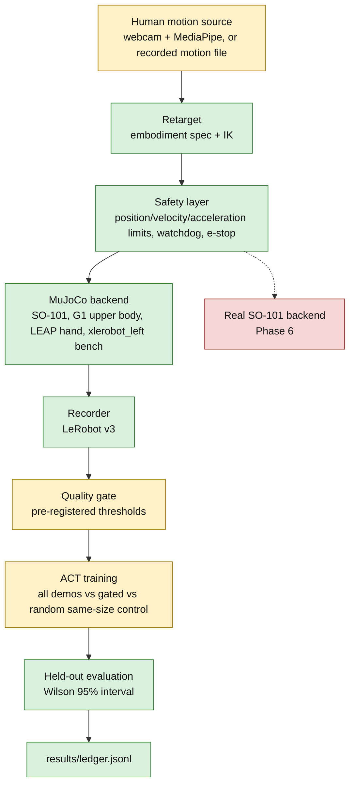

# XERT: cross-embodiment retargeting and learning

XERT sends one human motion stream through one middleware to several simulated
robot bodies, records the teleoperation data in LeRobot v3 format, and is built
to test whether a pre-registered quality gate on that data helps imitation
learning. An embodiment is one robot body with its own joints and limits.
On the scripted path, adding a robot means adding a model file and a YAML
spec, not controller code. Webcam control also needs a mapping profile in
`configs/teleop/`, and some vendor models need a preparation step first (G1's
legs and floating base are removed by `scripts/prepare_embodiments.py`).

Everything measured so far is MuJoCo simulation. There are no hardware results
and no human-data results yet. See [What is not shown](#what-is-not-shown).

The project grew out of a single-arm simulation workbench (`xle_workbench`, a
C++17 MuJoCo core with a CLI and HTTP API). That code still runs; the `xert/`
package sits beside it and reuses the native core.

## Pipeline



Green: implemented, reviewed and accepted. Yellow: software implemented and
reviewed, but acceptance needs a live webcam run or human demonstrations.
Red: not started (needs hardware). ACT training is accepted on scripted
demonstrations (P1.3, P1.4); the gated-data experiment has not run.

| Stage | Status | Explainer |
| --- | --- | --- |
| Results ledger | Complete | [P0.2](docs/learn/P0.2.md) |
| Windows and Linux build, CI | Complete | [P0.3](docs/learn/P0.3.md) |
| Learning on scripted demos: diagnosis, recovery demos, ACT-style model, LeRobot ACT reference | Complete (sim, scripted data) | [P1.1](docs/learn/P1.1.md), [P1.2](docs/learn/P1.2.md), [P1.3](docs/learn/P1.3.md), [P1.4](docs/learn/P1.4.md) |
| LeRobot v3 export and direct recorder | Complete | [P2.1](docs/learn/P2.1.md), [P2.2](docs/learn/P2.2.md) |
| Embodiment specs | Complete | [P3.1](docs/learn/P3.1.md) |
| Spec-driven damped least-squares IK | Complete | [P3.2](docs/learn/P3.2.md) |
| Safety layer | Complete | [P3.3](docs/learn/P3.3.md) |
| MuJoCo backend driving three bodies | Complete | [P3.4](docs/learn/P3.4.md) |
| Webcam source, calibration, runtime loop, latency | Partial: live calibration and latency runs pending | [P3.5](docs/learn/P3.5.md) |
| Retarget quality on a recorded clip | Partial: recorded human clip pending | [P3.6](docs/learn/P3.6.md) |
| Bench teleop collection | Partial: live webcam check pending | [P4.1](docs/learn/P4.1.md) |
| Human demonstrations (P4.2) | Pending: needs a person recording | none yet |
| Gate metrics | Partial: distributions need human demos | [P5.1](docs/learn/P5.1.md) |
| Gate thresholds (P5.2) | Pending: chosen from P5.1 distributions, committed before training | none yet |
| Gate experiment | Partial: harness reviewed, needs P4.2 and P5.2 | [P5.3](docs/learn/P5.3.md) |
| Real SO-101 (Phase 6) | Not started | none yet |
| Packaging | Software done, demo video pending | [P7](docs/learn/P7.md) |

The [acceptance tracker](docs/MVP_PROGRESS.md) is the source for status, and
[the interview notes index](docs/learn/INDEX.md) lists every explainer.

## Layout

| Path | Contents |
| --- | --- |
| `xert/spec` | Embodiment YAML specs (`so101`, `g1_upper`, `leap_hand`, `xlerobot_left`) and the validating loader |
| `xert/sources` | `MotionSource` protocol, MediaPipe webcam source, recorded motion-file source |
| `xert/retarget` | Human-to-robot target mapping, neutral-pose calibration, IK wrapper |
| `xert/safety` | Command limits and stale-input watchdog |
| `xert/backends` | `Backend` protocol, `MuJoCoBackend`, the native pick-and-place `BenchBackend` |
| `xert/runtime` | Fixed-rate loop, latency measurement, teleop collection, `xert` CLI commands |
| `xert/data` | LeRobot export, runtime recorder, gate metrics |
| `xert/eval` | Ledger, official LeRobot ACT runner, gate experiment harness |
| `xle_workbench` | Original workbench: collection, MLP and ACT-style training, evaluation, HTTP API |
| `cpp` | C++17 MuJoCo core and pybind11 bindings |
| `assets` | Vendored robot models with licenses, pinned commits and checksums |
| `results` | Ledger and measured artifacts |
| `docs/learn` | One short explainer per slice |

`python -m xert --help` lists the commands: `ledger show`, `calibrate`,
`latency`, `teleop`, `record-motion` and `quality`. Each webcam command opens a
camera only when run explicitly. The bare `xert` command exists only after
`pip install -e .`; otherwise use `python -m xert`, as below.

## What is measured

Numbers live only in [`results/ledger.jsonl`](results/ledger.jsonl), one JSON
row per measurement. This README does not repeat them. To see them:

```powershell
.\.venv\Scripts\python.exe -m scripts.resume_numbers   # resume-eligible rows, each with its id, backend, n, interval and caveat
.\.venv\Scripts\python.exe -m xert ledger show          # every raw row
```

The eligibility rule is written at the top of
[`scripts/resume_numbers.py`](scripts/resume_numbers.py). Reports generated
from ledger rows:

- [P1.3 held-out ACT-style evaluation](results/p1.3/act_v1/report.md)
- [P1.4 official LeRobot ACT comparison](results/p1.4/official_act_v1/comparison.md)
- `results/gate_experiment.md` is written by P5.3 when the gate experiment runs; it does not exist yet.

How the ledger works:

- Rows are append-only. A correction is a new row that references the old row
  ID; nothing is edited or deleted. A corrupt or incomplete ledger is rejected,
  not repaired.
- Each row records the source commit, whether the working tree was dirty, the
  backend (`mujoco` or `so101_hw`), the embodiment, seeds, configuration and
  artifact paths. A dirty source tree cannot be rebuilt from its commit alone.
- A missing valid confidence interval stays `null`. Repeated evaluation seeds
  are not pooled into extra trials.
- `xle_workbench.cli evaluate` and the HTTP benchmark job append rows; so do the
  slice scripts under `scripts/` and the `xert` measurement commands.
- Git provenance is captured before an evaluation starts. If the append fails,
  the operation fails; any simulation artifacts left behind are not
  ledger-backed evidence.
- Set `XERT_LEDGER_PATH` to a separate file for smoke runs. Pytest always uses a
  temporary ledger.

## What is not shown

- **No hardware.** No ledger row has backend `so101_hw`, and no motor driver or
  hardware backend exists. Spec velocity and acceleration limits are chosen
  simulation settings, not measured motor limits. The safety layer limits
  commanded positions in simulation; it is not certified hardware safety.
  Hardware work must start from measured kit geometry, joint signs, limits and
  timing, then supervised low-speed trials. Simulation actions are never
  forwarded straight to motors.
- **No human-data results.** Live webcam latency (P3.5), retarget error on a
  human clip (P3.6), teleop success (P4.1), gate-metric distributions (P5.1) and
  the gate result (P5.3) are all TBD (not measured). Scripted test clips and
  scripted recordings never write those rows.
- **Learning results use scripted data and privileged state.** P1.3 and P1.4
  train on noisy scripted-expert demonstrations and read object poses directly
  from the simulator. There are no camera observations. P1.3 and P1.4 differ in
  architecture, ensemble weighting and dependencies, so they are not a causal
  ablation.
- **xlerobot_left stands in for SO-101 on the bench.** The pick-and-place scene
  exists only for the older XLeRobot left arm, whose asset declares SO-ARM100
  geometry. Teleop and the learning results run on that arm and are labelled
  `xlerobot_left`, not SO-101. The Robot Studio SO-101 model is used by the
  middleware, without a block or tray.
- **Retargeting is a control mapping, not metric tracking.** The webcam mapping
  uses image position and apparent palm size as a depth proxy, relative to a
  neutral pose. Wrist rotation also changes palm size. Tracking confidence is
  unavailable and stays null; handedness scores only rate left/right labels.
- **Cross-embodiment evidence is scripted.** P3.4 drives SO-101, G1 and LEAP from
  one scripted clip. It shows the shared code path runs, not tracking quality,
  task success or learned transfer between robots.
- **IK evidence is local.** P3.2 measures reachable targets near the rest pose,
  not global reachability, collision avoidance or dynamics.
- **Some rows come from a dirty working tree.** `resume_numbers` labels them
  DIRTY. The [P1.3 report](results/p1.3/act_v1/report.md) explains why its
  evaluation rows carry that flag.
- **Latency, once measured, starts at host capture.** It excludes camera
  exposure and driver buffering.

## Next steps (owner)

These need a person at the webcam; scripted data cannot substitute.

1. **P3.5:** check known left and right hands in the camera view, capture a
   neutral calibration with `python -m xert calibrate`, then for each embodiment
   run `python -m xert latency --spec xert/spec/<robot>.yaml --profile
   configs/teleop/<robot>.json --calibration <neutral.json> --output <fresh dir>
   --duration 300`.
2. **P3.6:** record a human clip with `python -m xert record-motion --output
   results/p3.6/clip.json`, then run `python scripts/measure_retarget.py --clip
   results/p3.6/clip.json --output <fresh dir>`.
3. **P4.1:** run a live teleop session on the `xlerobot_left` bench.
4. **P4.2:** record the human demonstrations.
5. **P5.2:** choose gate thresholds from the P5.1 distributions and commit
   `configs/gate.yaml` before any gated training.
6. **P5.3:** run the gate experiment, which writes `results/gate_experiment.md`
   from the ledger.

Phase 7 also still needs its demo video.

## C++17 MuJoCo core

The physics loop, task scoring, delayed commands, the scripted inverse-kinematics
expert and the general IK solver are C++17 on the MuJoCo C API, bound to Python
with pybind11. Python owns the MuJoCo model and data; the binding works on them
in place, so both sides share one MuJoCo instance.

| Path | Contents |
|---|---|
| `cpp/src/env.cpp` | Reset, observations, float32 action quantisation, command-delay queue, 20 physics substeps per control tick, lift/hold/settle/success/failure logic |
| `cpp/src/ik.cpp` | Scripted pick-and-place phase schedule and damped least-squares IK (partial-pivoting 6x6 solve, joint-limit and rate clipping), plus the spec-driven solver |
| `cpp/src/bindings.cpp` | pybind11 module that works in place on the Python-owned `mjModel`/`mjData` |
| `cpp/src/trials.cpp` | Standalone `reach_trials` runner for scripted trials |
| `cpp/tests/test_core.cpp` | CTest checks: observation layout, action validation, delay queue, contact-based success |

Build on Windows (Visual Studio 2022 C++ Build Tools, CMake 3.20+, the project
`.venv`; the script installs pybind11 3.1.0 if missing):

```powershell
.\scripts\build_core.ps1
ctest --test-dir build -C Release
.\.venv\Scripts\python.exe -m pytest -q
.\.venv\Scripts\python.exe -m xle_workbench.cli export-bench --model build\bench.xml --positions build\positions.csv --seeds 0..8
.\build\Release\reach_trials.exe --model build\bench.xml --positions build\positions.csv
```

Build on Linux (Python 3.11, CMake 3.20+, Make and a C++17 compiler):

```bash
python3 -m venv .venv
.venv/bin/python -m pip install torch==2.14.0 --index-url https://download.pytorch.org/whl/cpu
.venv/bin/python -m pip install -r requirements-lock.txt
bash scripts/build_core.sh
.venv/bin/python -m pytest -q
ctest --test-dir build -C Release --output-on-failure
.venv/bin/python scripts/equivalence_check.py
```

The scripts use the `windows` and `linux` presets in `CMakePresets.json`. The
core links against the shared library in the installed `mujoco` wheel (3.14.0).
For headless rendering on Ubuntu, install `libosmesa6` and set
`MUJOCO_GL=osmesa`; the Linux CI job does this. `scripts/equivalence_check.py`
runs the original pure-Python simulator (`tests/reference_sim.py`) and the C++
core side by side and fails unless every observation matches exactly.
See [P0.3](docs/learn/P0.3.md).

## Python environments

The dependency stacks conflict. LeRobot 0.6.1 declares Python 3.12 or newer,
PyTorch below 2.12 and NumPy below 2.3, while the base environment pins PyTorch
2.14.0 on Python 3.11; the PyTorch pin is the real clash. The optional
environments use Python 3.13 by project choice. So there are four environments.
Build the native core once per environment, in its own build directory; the
[LeRobot setup notes](docs/LEROBOT_EXPORT.md) give the CMake command.

| Environment | Install | Used for |
| --- | --- | --- |
| Base `.venv` (Python 3.11) | `uv venv --python 3.11 .venv`, then `uv pip install --python .venv/Scripts/python.exe -r requirements-lock.txt` and `uv pip install --python .venv/Scripts/python.exe --no-deps -e .` | Native core, `xle_workbench`, ledger, specs, IK, safety, backends, base test suite |
| LeRobot `.venv-lerobot` (Python 3.13) | `uv pip sync requirements-act-windows-lock.txt --python .venv-lerobot/Scripts/python.exe --only-binary :all:` (the export-only lock is `requirements-lerobot-windows-lock.txt`) | LeRobot export, official ACT, recorder, gate metrics and harness tests |
| Vision (Python 3.11) | `requirements-lock.txt` plus `requirements-webcam-lock.txt`, as in the CI `webcam` job | MediaPipe webcam source, calibration, runtime tests |
| Teleop `build\venv-teleop` (Python 3.13) | `uv venv build/venv-teleop --python <Python313>/python.exe`, then `uv pip sync requirements-teleop-windows-lock.txt --python build/venv-teleop/Scripts/python.exe --only-binary :all:` only | LeRobot and MediaPipe in one Python: bench teleop recorded straight to LeRobot v3 |

Linux uses the matching `-linux-lock.txt` files. Never install the teleop lock
with a plain `pip install -r`: it would add `opencv-contrib-python` back, which
clashes with LeRobot's `opencv-python-headless` ([P4.1](docs/learn/P4.1.md)).
Tests that need an optional stack are skipped in the base environment; a skip
is not a pass.

PyTorch is CPU-only by default. `device: cuda` is accepted only when the
installed PyTorch supports CUDA; it never falls back silently.

## Original workbench (`xle_workbench`)

The pick-and-place task uses the pinned upstream XLeRobot left-arm chain on a
stationary bench. The block must be lifted, released into the tray, and stay
settled without robot contact. This is not a calibrated digital twin of a
physical kit. Observations are simulator state. Models are a behavior-cloning
MLP and a state-based ACT-style CVAE transformer with optional temporal
ensembling ([P1.3](docs/learn/P1.3.md)).

```powershell
.\.venv\Scripts\python.exe -m xle_workbench.cli --output data/collection.json collect --episodes 10 --seed 0
.\.venv\Scripts\python.exe -m xle_workbench.cli --output data/baseline.json train --collection data/collection.json --config '@configs/baseline.json'
.\.venv\Scripts\python.exe -m xle_workbench.cli --output data/act.json train --collection data/collection.json --config '@configs/act.json'
.\.venv\Scripts\python.exe -m xle_workbench.cli evaluate --model MODEL_ID --episodes 10 --seed 10000
.\.venv\Scripts\python.exe -m xle_workbench.cli replay EPISODE_ID --image data/replay.png
.\.venv\Scripts\python.exe -m xle_workbench.cli --data data/smoke smoke --epochs 2 --model-type act
```

`evaluate` without `--model` runs the scripted baseline. `smoke` is an
integration run: a working pipeline does not mean the briefly trained policy
succeeds at manipulation.

`python -m xle_workbench.cli serve` starts a localhost FastAPI service; open
`http://127.0.0.1:8765/docs`. It has no remote authentication or multi-user
scheduler, and closing it interrupts active jobs and discards unsaved sessions.

| Endpoint | What it does |
|---|---|
| `GET /environment` | Robot schema, joint order, units, action conventions and default configuration |
| `POST /sessions`, `POST /sessions/{id}/step`, `GET /sessions/{id}/frame.png`, `POST /sessions/{id}/save`, `DELETE /sessions/{id}` | Seeded live simulation: step normalized joint targets or an expert step, render, save, close |
| `POST /jobs/collect`, `/jobs/train`, `/jobs/evaluate`, `/jobs/benchmark` | Scripted collection, training on episode IDs, evaluation on new seeds, friction/delay benchmark on identical seeds |
| `GET /jobs/{id}`, `POST /jobs/{id}/cancel` | Durable progress and cooperative cancellation |
| `GET /episodes/{id}/arrays`, `/replay`, `/frame.png`, `/download` | Inspect transitions, re-run recorded actions, render, download the checked NPZ |
| `POST /episodes/import` | Import raw NPZ only after seed/config resimulation verifies its transitions |
| `GET /models`, `GET /evaluations` | Checkpoint provenance and measured reports |

Example body for `POST /jobs/benchmark`:

```json
{
  "seeds": [10000, 10001, 10002],
  "model_ids": ["REPLACE_WITH_MODEL_ID"],
  "conditions": [
    {"friction": 1.0, "delay_steps": 0},
    {"friction": 0.6, "delay_steps": 0},
    {"friction": 1.0, "delay_steps": 2}
  ]
}
```

Session actions are absolute normalized joint targets. `expert=true` selects
the scripted controller; those are not human demonstrations. Simulation import
needs the original seed and configuration; it is not a LeRobot dataset or
hardware-log importer. Evaluation seeds cannot overlap demonstration seeds, and
changing the horizon invalidates a checkpoint's schema contract. Reports include
seeds, exact configuration, outcome reasons, trace IDs and a success-rate
interval; small trial counts remain small evidence.

Artifacts live under `data/episodes`, `data/models`, `data/evaluations` and
`data/jobs`. Hashes detect accidental changes; they are not signatures. Upstream
assets are vendored with license, source revision and checksums under `assets/`.

Older background docs: [engineering notebook](docs/ENGINEERING_NOTEBOOK.md),
[simulation decisions](docs/SIMULATION.md), [learning](docs/LEARNING.md),
[rebuild guide](docs/BUILD_IT_YOURSELF.md) and the
[P0.1 audit (2026-10-20)](docs/STATE_OF_REPO.md). The audit is a dated snapshot,
now partly stale; it lists the parts of the older docs that were already out of
date then.
